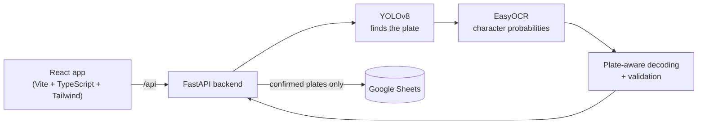

# Car Number Plate Detection & Vehicle Tracking System

Detects Indian number plates in photos with a custom-trained YOLOv8 model, reads them with EasyOCR,
and logs confirmed plates to Google Sheets. Comes with a FastAPI backend and a mobile-friendly React
web app, so you can scan plates straight from a phone camera.

<p>
  
  
</p>

## Features

- **Plate detection** with YOLOv8 (`backend/models/best.pt`)
- **Plate-aware OCR** – the text is decoded straight from EasyOCR's character probabilities, and only
  valid Indian plates are allowed: a real state code, then RTO digits, series letters and number digits
  (or the BH layout). So an unclear character in a digit position becomes the most likely *digit*.
- **Format validation** for standard plates (`MH12DE1433`, `DL3CAB1234`) and Bharat series (`22BH6517A`)
- **Two-row plates** (bikes, autos, trucks) are read top to bottom as one plate
- **Review before saving** – unclear reads are flagged and the text can be edited
- **Google Sheets log** with duplicate protection, retries and clear error messages
- **Web app** – drag-and-drop or phone camera, several images at once, boxes drawn on the image,
  searchable log with CSV export

| Phone | Log |
|---|---|
|  |  |

*Screenshots are from a real run on `backend/test_images/` before Google Sheets was connected,
which is why saving is disabled there.*

## Accuracy

Measured with [`backend/scripts/evaluate.py`](backend/scripts/evaluate.py) on 76 hand-labelled plates
from the training dataset (photos of Indian cars, many small or blurry), full image → detection → OCR:

| | Before | Now |
|---|---|---|
| Plates read exactly right | 29 / 76 (38%) | **54 / 76 (71%)** |
| Character error rate | 19.4% | **6.1%** |
| Accepted without review *and* correct | 23 | **37** |
| Accepted without review but **wrong** | 7 | **4** |
| Time for all 76 (CPU) | 742 s | **611 s** |

What made the difference, each step measured on the same plates (OCR only, on the labelled boxes):

| Change | Exact | Char. errors |
|---|---|---|
| Old pipeline | 35.5% | 19.6% |
| + plate-aware decoding | 48.7% | 14.2% |
| + crop margin relative to the plate (was a fixed 25 px) and resizing every crop to a set height | 64.5% | 6.8% |
| + pick the text most preprocessing variants agree on, crop height 140 px | 72.4% | 6.9% |

Notes: the labels were made by reading the crops by eye, skipping any plate that couldn't be read
with certainty. Some of these images were in the YOLO training set, so the detection part is
easier than on new photos. The OCR part wasn't trained on them. The crop height (140) was picked
from three values tried on this same set.

## How it works



1. The user uploads photos or takes one with the phone camera.
2. YOLOv8 finds each plate. The crop gets a small margin so edge characters aren't cut off,
   and is resized to a standard height.
3. Four versions of the crop (plain, contrast-enhanced, two thresholded) go through EasyOCR.
   Its text boxes are grouped into rows, top to bottom.
4. For each version the most probable *valid plate* is decoded from the character probabilities.
   The text most versions agree on wins.
5. The user checks the result, edits it if needed and presses **Save to log**.
6. The backend appends a row to Google Sheets, unless the same plate was saved in the last 10 minutes.

## Project structure

```
├── backend/
│   ├── app/
│   │   ├── api/          FastAPI app: routes, schemas, upload checks, error handlers
│   │   ├── pipeline.py   Detection + OCR pipeline
│   │   ├── decoding.py   Plate-aware decoding of OCR probabilities
│   │   ├── plates.py     Indian plate formats and validation
│   │   ├── sheets.py     Google Sheets log (lazy connect, retries, dedupe)
│   │   └── config.py     Settings from config.toml + env vars
│   ├── scripts/
│   │   ├── detect.py     Run detection from the command line
│   │   ├── evaluate.py   Measure accuracy on labelled plates
│   │   └── train.py      Train the YOLOv8 detector
│   ├── benchmark/        Labelled plates for evaluate.py
│   ├── tests/            pytest tests (model and Sheets are mocked)
│   ├── models/best.pt    Trained plate detector
│   ├── test_images/      Sample photos
│   ├── config.toml       Thresholds, limits, Sheets settings
│   └── Dockerfile
├── frontend/             React web app
├── secrets/              Your Google service account key (git-ignored)
├── data/                 Training dataset (git-ignored)
└── docker-compose.yml
```

## Running it

### With Docker

```bash
cp .env.example .env              # sheet name / ID
mkdir secrets && cp path/to/key.json secrets/credentials.json
docker compose up --build
```

Open http://localhost:8080. The backend takes a minute or two to load the models on first start.

### Without Docker

Backend (Python 3.12):

```bash
python -m venv venv
venv\Scripts\activate             # macOS/Linux: source venv/bin/activate
cd backend
pip install -r requirements.txt
uvicorn app.api.main:app --reload
```

API docs: http://localhost:8000/docs

Frontend (Node 20), in a second terminal:

```bash
cd frontend
npm install
npm run dev
```

Open http://localhost:5173. Vite forwards `/api` to the backend on port 8000.

To use the phone camera during development, run `npm run dev -- --host` and open the
network URL it prints on your phone (same Wi-Fi).

Command line tools (from `backend/`):

```bash
python -m scripts.detect                       # every image in test_images/
python -m scripts.detect path/to/photo.jpg -v
python -m scripts.evaluate                     # accuracy on benchmark/dataset_plates.csv (needs data/)
python -m scripts.evaluate --mode e2e          # same, including detection
python -m scripts.train --epochs 50            # retrain the detector on data/archive
```

## Google Sheets setup

Confirmed plates are logged to the Google Sheet **Vehicle_Tracking_System** through a service account.

1. In [Google Cloud Console](https://console.cloud.google.com/) create a project (or use one)
   and enable the **Google Sheets API** and **Google Drive API**.
2. Go to *IAM & Admin → Service Accounts*, create a service account, then
   *Keys → Add key → JSON*. Save the file as `secrets/credentials.json` (git-ignored, never commit it).
3. Create a Google Sheet called `Vehicle_Tracking_System` and **share it with the service account's
   email** (the `client_email` in the JSON) as **Editor**.

That's it. To use a different sheet, change `spreadsheet_name` in `backend/config.toml`.

The app asks Google for Sheets access plus read-only Drive *metadata* access, which is only used to
find the sheet by its name. If you set `spreadsheet_id` (the long ID in the sheet's URL) instead,
the Drive permission isn't requested at all and the Drive API isn't needed.

Instead of the key file you can also use environment variables, which is handier on a server:

| Variable | Value |
|---|---|
| `GOOGLE_CREDENTIALS` | The whole JSON key as a string |
| `GOOGLE_APPLICATION_CREDENTIALS` | Path to the JSON key |
| `VDS_SHEETS_SPREADSHEET_NAME` / `VDS_SHEETS_SPREADSHEET_ID` | Which sheet to use |

Columns written for each saved plate:

| Plate | Timestamp (IST) | Source | Detection Conf | OCR Conf | Format |
|---|---|---|---|---|---|

A header row is added if the sheet is empty. Rows from older versions of the app (plate, time,
source only) are still read fine.

If Sheets isn't set up the app still runs and detection still works. The **Sheets** status in the
header (or `GET /api/health`) tells you what's missing.

## Configuration

Everything lives in [`backend/config.toml`](backend/config.toml): detection confidence, crop size,
OCR thresholds, upload limits, allowed frontend origins (CORS), the dedupe window and the Sheets
settings. Any value can be overridden with an environment variable named `VDS_<SECTION>_<KEY>`,
e.g. `VDS_MODEL_CONFIDENCE=0.4` or `VDS_API_CORS_ORIGINS=https://plates.example.com`.

## API

| Endpoint | What it does |
|---|---|
| `GET /api/health` | Model and Google Sheets status |
| `POST /api/detect` | Upload up to 10 images as `files`. Returns per image: status, message, size, time, and per plate: box, text, raw OCR text, detection and OCR confidence, format, `valid`, `needs_review` and a cropped plate image |
| `POST /api/logs` | Save a confirmed plate: `{"plate": "MH12DE1433", "source": "camera", "det_conf": 0.91, "ocr_conf": 0.8}`. Returns 409 if the same plate was saved within `dedupe_minutes`, 422 if it isn't a valid plate |
| `GET /api/logs` | Saved plates, newest first. Query: `q`, `format`, `source`, `limit` |

Errors always look like this, never a stack trace:

```json
{ "error": { "code": "DUPLICATE_PLATE", "message": "MH12DE1433 was already logged 3 min ago. ..." } }
```

## Tests

```bash
cd backend
pip install -r requirements-dev.txt
pytest                          # plate rules, decoding, pipeline, Sheets, API

cd ../frontend
npm test                        # plate rules, CSV, API client, plate card
npm run typecheck
```

The backend tests mock the model and Google Sheets, so they don't need credentials or a GPU.

## Known limitations

- **OCR still gets about 3 in 10 plates wrong** on the benchmark, mostly small, blurry or stylised
  ones. Most of those are flagged *Needs review*, but 4 of 76 were wrong and not flagged, so it's worth
  a glance before saving. Example: `RJ14CV0002` in `test_images/testing 2.png` has a stylised 4 that
  EasyOCR reads as L; it's flagged for review.
- **Speed on CPU:** about 2–11 s per photo for the sample images on my laptop (4 cores), most of it
  OCR. Requests are processed one at a time. A GPU (`[ocr] gpu = true`) should help but hasn't been
  tested here.
- **Only standard and BH plates are accepted.** Defence, diplomatic and temporary plates are marked
  invalid and can't be saved.
- **No HEIC.** iPhone photos uploaded from the gallery may be HEIC. Use JPEG/PNG or set the camera
  to *Most Compatible*. The camera button in the app normally gives JPEG.
- **Duplicate check is per backend.** It uses the sheet's rows plus an in-memory cache, so two backend
  instances writing at the same moment could both log the same plate.
- **Rare duplicate rows on network errors.** If Google times out after a row was actually written,
  the retry can add it twice.
- **The log reads the whole sheet** (cached for 15 s) and shows the latest 1000 rows. Very large sheets
  will get slow; archive old rows now and then.
- The Docker setup is written but hasn't been run on this machine (no Docker here), so treat it as a
  starting point.

## Author

Mohnish Shandilya
