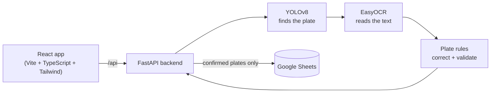

# Car Number Plate Detection & Vehicle Tracking System

Detects Indian number plates in photos with a custom-trained YOLOv8 model, reads them with EasyOCR,
and logs confirmed plates to Google Sheets. Comes with a FastAPI backend and a mobile-friendly React
web app, so you can scan plates straight from a phone camera.

<p>
  
  
</p>

## Features

- **Plate detection** with YOLOv8 (`models/best.pt`, trained with `src/train.py`)
- **OCR with position-aware correction** – fixes common mix-ups (0/O, 1/I, 2/Z, 5/S, 8/B) only where the
  plate format expects a letter or a digit, so `DL3CAB1234` stays `DL3CAB1234`
- **Format validation** for standard plates (`MH12DE1433`) and Bharat series (`22BH6517A`)
- **Two-row plates** (bikes, autos, trucks) are read top to bottom
- **Review before saving** – low-confidence reads are flagged and the text can be edited
- **Google Sheets log** with duplicate protection, retries and clear error messages
- **Web app** – drag-and-drop or phone camera, several images at once, boxes drawn on the image,
  searchable log with CSV export

| Phone | Log |
|---|---|
|  |  |

*Screenshots are from a real run on the images in `test_images/`. Google Sheets wasn't connected
at the time, which is why saving is disabled and the log shows the setup message.*

## How it works



1. The user uploads photos or takes one with the phone camera.
2. YOLOv8 finds each plate. The crop gets a margin around it so edge characters aren't cut off.
3. EasyOCR reads several preprocessed versions of the crop. Text rows are joined top to bottom.
4. The text is corrected by position and checked against the Indian plate formats.
5. The user checks the result, edits it if needed and presses **Save to log**.
6. The backend appends a row to Google Sheets, unless the same plate was saved in the last 10 minutes.

## Project structure

```
├── src/
│   ├── api/            FastAPI app: routes, schemas, upload checks, error handlers
│   ├── pipeline.py     Detection + OCR pipeline (shared by the API and the CLI)
│   ├── plates.py       Indian plate formats, OCR correction, validation
│   ├── sheets.py       Google Sheets log (lazy connect, retries, dedupe)
│   ├── config.py       Settings from config.toml + env vars
│   ├── detect.py       Command-line detection
│   └── train.py        YOLOv8 training
├── frontend/           React web app
├── tests/              pytest tests (model and Sheets are mocked)
├── models/best.pt      Trained plate detector
├── config.toml         Thresholds, limits, Sheets settings
├── Dockerfile          Backend image
└── docker-compose.yml  Backend + frontend
```

## Running it

### With Docker

```bash
cp .env.example .env              # set SPREADSHEET_ID
mkdir secrets && cp path/to/key.json secrets/credentials.json
docker compose up --build
```

Open http://localhost:8080. The backend takes a minute or two to load the models on first start.

### Without Docker

Backend (Python 3.12):

```bash
python -m venv venv
venv\Scripts\activate             # macOS/Linux: source venv/bin/activate
pip install -r requirements.txt
uvicorn src.api.main:app --reload
```

API docs: http://localhost:8000/docs

Frontend (Node 20):

```bash
cd frontend
npm install
npm run dev
```

Open http://localhost:5173. Vite forwards `/api` to the backend on port 8000.

To use the phone camera during development, run `npm run dev -- --host` and open the
network URL it prints on your phone (same Wi-Fi).

Command line, without the web app:

```bash
python -m src.detect                    # every image in test_images/
python -m src.detect path/to/photo.jpg -v
```

## Google Sheets setup

Confirmed plates are logged to a Google Sheet through a service account.
The app only asks for access to Sheets, not the rest of your Drive.

1. In [Google Cloud Console](https://console.cloud.google.com/) create a project (or use one)
   and enable the **Google Sheets API**.
2. Go to *IAM & Admin → Service Accounts*, create a service account, then
   *Keys → Add key → JSON*. Save the file as `src/credentials.json`
   (or `secrets/credentials.json` for Docker). Both are git-ignored, never commit them.
3. Create a Google Sheet and **share it with the service account's email**
   (the `client_email` in the JSON) as **Editor**.
4. Copy the sheet ID from its URL, `https://docs.google.com/spreadsheets/d/<SHEET_ID>/edit`,
   into `config.toml`:

   ```toml
   [sheets]
   spreadsheet_id = "<SHEET_ID>"
   worksheet = ""   # empty = first tab
   ```

Instead of the file you can also use environment variables, which is handier on a server:

| Variable | Value |
|---|---|
| `GOOGLE_CREDENTIALS` | The whole JSON key as a string |
| `GOOGLE_APPLICATION_CREDENTIALS` | Path to the JSON key |
| `VDS_SHEETS_SPREADSHEET_ID` | The sheet ID |

If the sheet is empty a header row is added on first connect:

| Plate | Timestamp (IST) | Source | Detection Conf | OCR Conf | Format |
|---|---|---|---|---|---|

If Sheets isn't set up the app still runs and detection still works. The **Sheets** status in the
header (or `GET /api/health`) tells you what's missing.

## Configuration

Everything lives in [`config.toml`](config.toml): detection confidence, crop padding, OCR thresholds,
upload limits, allowed frontend origins (CORS), the dedupe window and the Sheets retry settings.
Any value can be overridden with an environment variable named `VDS_<SECTION>_<KEY>`,
e.g. `VDS_MODEL_CONFIDENCE=0.4` or `VDS_API_CORS_ORIGINS=https://plates.example.com`.

## API

| Endpoint | What it does |
|---|---|
| `GET /api/health` | Model and Google Sheets status |
| `POST /api/detect` | Upload up to 10 images as `files`. Returns per image: status, message, size, time, and per plate: box, text, raw OCR text, detection and OCR confidence, format, `valid`, `needs_review` and a cropped plate image |
| `POST /api/logs` | Save a confirmed plate: `{"plate": "MH12DE1433", "source": "camera", "det_conf": 0.91, "ocr_conf": 0.8}`. Returns 409 if the same plate was saved within `dedupe_minutes`, 422 if it isn't a valid plate |
| `GET /api/logs` | Saved plates, newest first. Query: `q`, `format`, `source`, `limit` |

Errors always look like this, never a stack trace:

```json
{ "error": { "code": "DUPLICATE_PLATE", "message": "MH12DE1433 was already logged 3 min ago. ..." } }
```

## Tests

```bash
pip install -r requirements-dev.txt
pytest                          # backend: plate rules, pipeline, Sheets, API

cd frontend
npm test                        # frontend: plate rules, CSV, API client, plate card
npm run typecheck
```

The backend tests mock the model and Google Sheets, so they don't need credentials or a GPU.

## Known limitations

- **OCR isn't perfect.** Stylised fonts trip it up: `RJ14CV0002` in `test_images/testing 2.png` is read
  as `RJ1GCV0002`. Only the 0/O, 1/I, 2/Z, 5/S and 8/B mix-ups are corrected, so a 4 read as G can't be
  fixed automatically. Reads like this are marked *Needs review* so they can be corrected before saving.
- **Slow on CPU.** A single image took about 20–40 s on my laptop CPU (4 cores), most of it OCR.
  Requests are processed one at a time. EasyOCR and YOLO can use a GPU (`[ocr] gpu = true`),
  but that hasn't been tested here.
- **Only standard and BH plates are accepted.** Defence, diplomatic and temporary plates are marked
  invalid and can't be saved.
- **No HEIC.** iPhone photos uploaded from the gallery may be HEIC. Use JPEG/PNG or set the camera
  to *Most Compatible*. The camera button in the app normally gives JPEG.
- **Duplicate check is per backend.** It uses the sheet's rows plus an in-memory cache, so two backend
  instances writing at the same moment could both log the same plate.
- **Rare duplicate rows on network errors.** If Google times out after a row was actually written,
  the retry can add it twice.
- **The log reads the whole sheet** (cached for 15 s) and shows the latest 1000 rows. Very large sheets
  will get slow; archive old rows now and then.
- **Box and text don't track the plate live.** The camera takes a photo; there's no video stream.
- The Docker setup is written but hasn't been run on this machine (no Docker here), so treat it as a
  starting point.

## Author

Mohnish Shandilya
