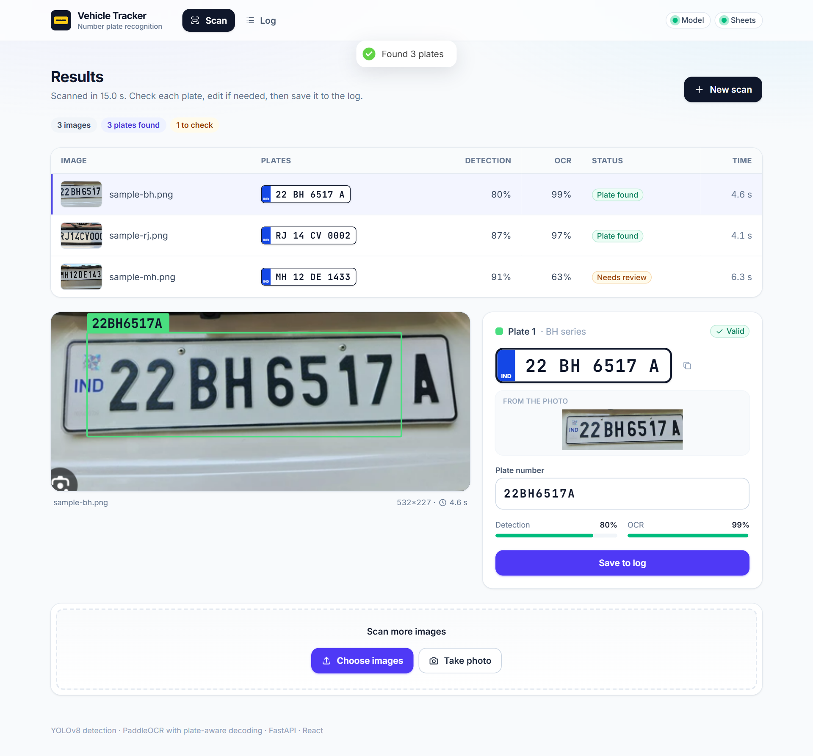
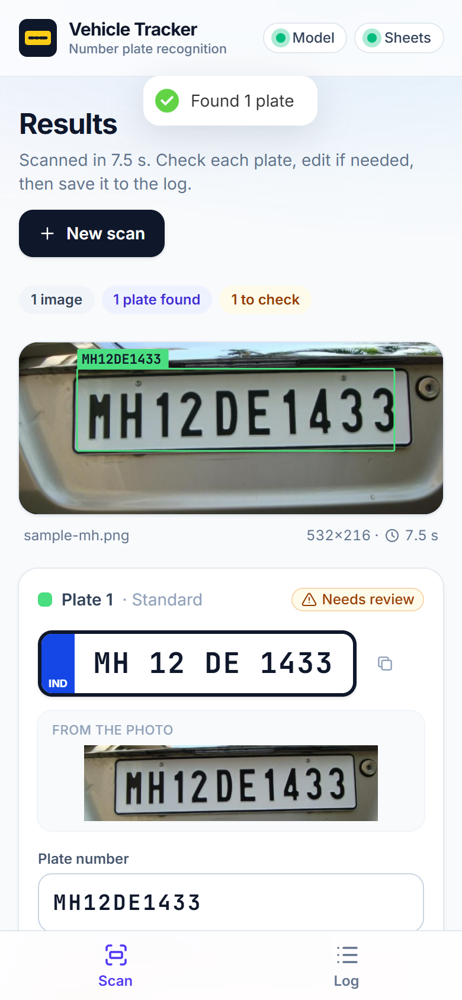
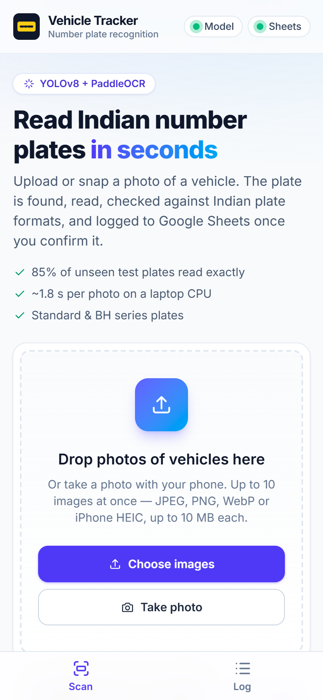
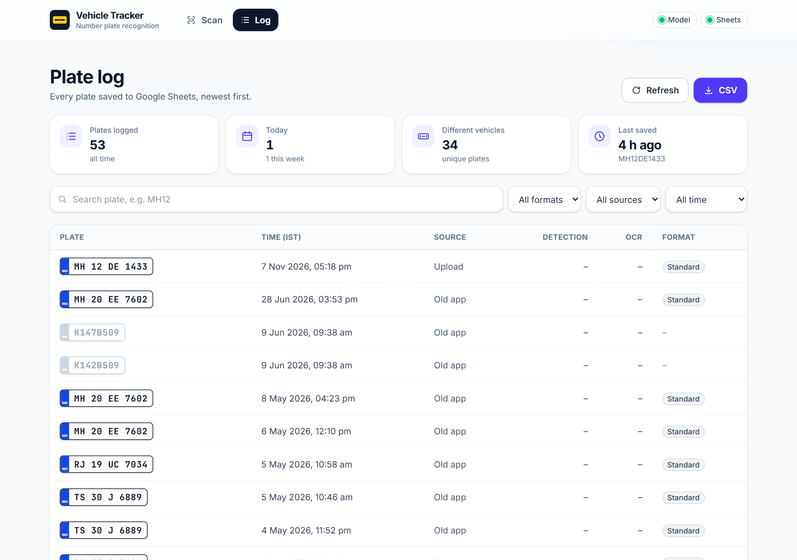
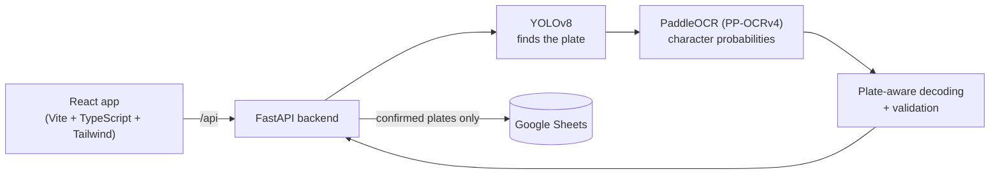

# Car Number Plate Detection & Vehicle Tracking System

Detects Indian number plates in photos with a custom-trained YOLOv8 model, reads them with
PaddleOCR (PP-OCRv4, run on onnxruntime through RapidOCR), and logs confirmed plates to Google Sheets. Comes with a FastAPI backend and a mobile-friendly React
web app, so you can scan plates straight from a phone camera.

<p>
  
  
</p>

## Features

- **Plate detection** with YOLOv8 (`backend/models/best.pt`)
- **Plate-aware OCR** – the text is decoded straight from the recognizer's character probabilities, and
  only valid Indian plates are allowed: a real state code, then RTO digits, series letters and number
  digits (or the BH layout). So an unclear character in a digit position becomes the most likely *digit*.
  PaddleOCR is the default; EasyOCR can be switched on as well, and both then vote.
- **Format validation** for standard plates (`MH12DE1433`, `DL3CAB1234`) and Bharat series (`22BH6517A`)
- **Two-row plates** (bikes, autos, trucks) are read top to bottom as one plate
- **Review before saving** – unclear reads are flagged and the text can be edited
- **Google Sheets log** with duplicate protection, retries and clear error messages
- **Web app** – drag-and-drop or phone camera (JPEG, PNG, WebP, iPhone HEIC), one-click sample photos,
  several images at once, boxes drawn on the image (hover a plate to highlight it), plates shown as
  real number plates, searchable log with stats, copy-to-clipboard and CSV export

| Phone | Log |
|---|---|
|  |  |

*Screenshots are from a real run of the app on the three sample photos in `backend/test_images/`,
which the Scan page also offers as one-click samples.*

## Accuracy

Every number here comes from a JSON report in [`backend/benchmark/reports/`](backend/benchmark/reports/),
written by [`scripts/evaluate.py`](backend/scripts/evaluate.py). CPU only, on an Intel Core
i3-1115G4 (2 cores, 4 threads).

There are two labelled sets (details in [`backend/benchmark/README.md`](backend/benchmark/README.md)):
**dev**, 76 plates used while tuning, and a **held-out test set**, 68 plates (57 distinct) that were
labelled afterwards and never looked at while changing the code. The test set is the honest number.

**Held-out test set**, full image → detection → OCR
([`heldout_baseline_e2e.json`](backend/benchmark/reports/heldout_baseline_e2e.json) →
[`heldout_e2e.json`](backend/benchmark/reports/heldout_e2e.json)):

| | EasyOCR (before) | PaddleOCR (now) |
|---|---|---|
| Plates read exactly right | 37 / 68 (54.4%) | **58 / 68 (85.3%)** |
| Character error rate | 18.0% | **6.3%** |
| Accepted without review *and* correct | 27 | **45** |
| Accepted without review but **wrong** | 7 | **0** |
| Correct, but flagged for review anyway | 10 | 13 |

| Held-out category (now) | Exact | Char. errors |
|---|---|---|
| Standard plates | 27 / 30 | 2.4% |
| Small (plate under 32 px tall) | 27 / 32 | 8.4% |
| Two-row | 4 / 6 | 15.2% |
| Video frames, unseen by detector and OCR tuning (was 5 / 26) | 19 / 26 | 13.5% |

0 wrong-but-accepted out of 68 doesn't mean it can't happen: with 68 plates the true rate could still
be up to about 4% (rule of three, 95%). It's worth a glance before saving.

**Dev set** (tuning score, same pipeline): 54 / 76 exact before → **69 / 76** now, wrong-but-accepted
4 → 0 ([`baseline.json`](backend/benchmark/reports/baseline.json),
[`dev_e2e.json`](backend/benchmark/reports/dev_e2e.json)). The README used to quote the dev score
(71%) as the accuracy; on the held-out set the same pipeline read 54%.

What made the difference, chosen on the dev set with [`scripts/tune.py`](backend/scripts/tune.py)
(OCR on the labelled boxes, [`tuning.json`](backend/benchmark/reports/tuning.json)):

| OCR engine (same plate-aware decoder and voting) | Exact | Char. errors | Wrong but accepted |
|---|---|---|---|
| EasyOCR, 4 preprocessing variants | 55 / 76 | 6.9% | 5 |
| **PaddleOCR**, colour + contrast-enhanced crop | **69 / 76** | 1.9% | 3 |
| Both (6 variants voting) | 69 / 76 | 1.1% | 5 |

PaddleOCR alone won: as many plates as both together, fewer wrong-but-accepted, and much less work.
The review threshold (`min_confidence`) went from 0.5 to 0.9, which on dev cut wrong-but-accepted
from 3 to 1 at the cost of flagging 19 of 69 correct reads (the full trade-off table is in
`tuning.json`). Tried on dev and dropped because they didn't help (quick runs, not saved as
reports): letting the decoder read look-alike letters as digits (D→0, L→4), and other ways of
combining the variants' votes (summed confidence, highest confidence).

Labels were made by reading the crops by eye, skipping plates that couldn't be read with certainty,
so both sets lean towards legible plates.

## Speed

[`scripts/benchmark.py`](backend/scripts/benchmark.py), the three photos in `test_images/` × 5 runs,
same i3-1115G4, CPU only ([`benchmark.json`](backend/benchmark/reports/benchmark.json)):

| Per image, detection + OCR | Mean | p95 | Images / s |
|---|---|---|---|
| EasyOCR (before) | 4.33 s | 10.86 s | 0.34 |
| **PaddleOCR (now)** | **1.81 s** | **3.03 s** | **0.57** |
| PaddleOCR + detector exported to ONNX | 1.91 s | 3.17 s | 0.52 |
| PaddleOCR, 2 pipeline instances, 4 images at a time | 2.02 s | 3.96 s | 0.50 |

OCR takes most of the time, so the ONNX detector didn't help, and with 2 cores two pipeline instances
just compete for the CPU. Both stay off by default; `[model] instances` is there for bigger machines.

## How it works



1. The user uploads photos or takes one with the phone camera.
2. YOLOv8 finds each plate. The crop gets a small margin so edge characters aren't cut off,
   and is resized to a standard height.
3. PaddleOCR finds the text lines in the colour crop and reads them. Its per-character
   probabilities are mapped onto A–Z and 0–9, and the lines are grouped into rows, top to bottom.
4. The most probable *valid plate* is decoded from those probabilities. If that read is confident
   and needed no corrections, it's used; otherwise a contrast-enhanced version of the crop is read
   too and the versions vote.
5. The user checks the result, edits it if needed and presses **Save to log**.
6. The backend appends a row to Google Sheets, unless the same plate was saved in the last 10 minutes.

## Project structure

```
├── backend/
│   ├── app/
│   │   ├── api/          FastAPI app: routes, schemas, upload checks, error handlers
│   │   ├── pipeline.py   Detection + OCR pipeline
│   │   ├── decoding.py   Plate-aware decoding of OCR probabilities
│   │   ├── plates.py     Indian plate formats and validation
│   │   ├── sheets.py     Google Sheets log (lazy connect, retries, dedupe)
│   │   └── config.py     Settings from config.toml + env vars
│   ├── scripts/
│   │   ├── detect.py     Run detection from the command line
│   │   ├── evaluate.py   Measure accuracy on labelled plates, write a JSON report
│   │   ├── tune.py       Compare OCR engines / thresholds on the dev set (cached OCR)
│   │   ├── benchmark.py  Measure speed per image and throughput
│   │   └── train.py      Train the YOLOv8 detector
│   ├── benchmark/        Dev and held-out labelled plates, reports/ with every measured number
│   ├── tests/            pytest tests (model and Sheets are mocked)
│   ├── models/best.pt    Trained plate detector
│   ├── test_images/      Sample photos
│   ├── config.toml       Thresholds, limits, Sheets settings
│   └── Dockerfile
├── frontend/             React web app
├── secrets/              Your Google service account key (git-ignored)
├── data/                 Training dataset (git-ignored)
└── docker-compose.yml
```

## Running it

### With Docker

```bash
cp .env.example .env              # sheet name / ID
mkdir secrets && cp path/to/key.json secrets/credentials.json
docker compose up --build
```

Open http://localhost:8080. The backend takes a minute or two to load the models on first start.

### Without Docker

Backend (Python 3.12):

```bash
python -m venv venv
venv\Scripts\activate             # macOS/Linux: source venv/bin/activate
cd backend
pip install -r requirements.txt
uvicorn app.api.main:app --reload
```

API docs: http://localhost:8000/docs

Frontend (Node 20), in a second terminal:

```bash
cd frontend
npm install
npm run dev
```

Open http://localhost:5173. Vite forwards `/api` to the backend on port 8000.

**If the page says the backend isn't running** or "Port 5173 is already in use":

- The backend terminal must show `Application startup complete` (the first start takes ~10–20 s).
  The page reconnects by itself once it does.
- Another dev server is still holding a port. Close the old terminal, or find and stop it:
  `netstat -ano | findstr ":5173 :8000"` then `taskkill /PID <pid> /T /F`.
  The frontend refuses to start on another port on purpose, so you never end up on a stale page.

To use the phone camera during development, run `npm run dev -- --host` and open the
network URL it prints on your phone (same Wi-Fi).

Command line tools (from `backend/`):

```bash
python -m scripts.detect                       # every image in test_images/
python -m scripts.detect path/to/photo.jpg -v
python -m scripts.evaluate                     # dev set, OCR on the labelled boxes (needs data/)
python -m scripts.evaluate --labels benchmark/heldout_plates.csv --mode e2e --report benchmark/reports/x.json
python -m scripts.tune                         # sweep OCR engines and review thresholds on dev
python -m scripts.benchmark                    # speed on test_images/
python -m scripts.train --epochs 50            # retrain the detector on data/archive
```

## Google Sheets setup

Confirmed plates are logged to the Google Sheet **Vehicle_Tracking_System** through a service account.

1. In [Google Cloud Console](https://console.cloud.google.com/) create a project (or use one)
   and enable the **Google Sheets API** and **Google Drive API**.
2. Go to *IAM & Admin → Service Accounts*, create a service account, then
   *Keys → Add key → JSON*. Save the file as `secrets/credentials.json` (git-ignored, never commit it).
3. Create a Google Sheet called `Vehicle_Tracking_System` and **share it with the service account's
   email** (the `client_email` in the JSON) as **Editor**.

That's it. To use a different sheet, change `spreadsheet_name` in `backend/config.toml`.

The app asks Google for Sheets access plus read-only Drive *metadata* access, which is only used to
find the sheet by its name. If you set `spreadsheet_id` (the long ID in the sheet's URL) instead,
the Drive permission isn't requested at all and the Drive API isn't needed.

Instead of the key file you can also use environment variables, which is handier on a server:

| Variable | Value |
|---|---|
| `GOOGLE_CREDENTIALS` | The whole JSON key as a string |
| `GOOGLE_APPLICATION_CREDENTIALS` | Path to the JSON key |
| `VDS_SHEETS_SPREADSHEET_NAME` / `VDS_SHEETS_SPREADSHEET_ID` | Which sheet to use |

Columns written for each saved plate:

| Plate | Timestamp (IST) | Source | Detection Conf | OCR Conf | Format |
|---|---|---|---|---|---|

A header row is added if the sheet is empty. Rows from older versions of the app (plate, time,
source only) are still read fine.

If Sheets isn't set up the app still runs and detection still works. The **Sheets** status in the
header (or `GET /api/health`) tells you what's missing.

## Configuration

Everything lives in [`backend/config.toml`](backend/config.toml): detection confidence, crop size,
OCR thresholds, upload limits, allowed frontend origins (CORS), the dedupe window and the Sheets
settings. Any value can be overridden with an environment variable named `VDS_<SECTION>_<KEY>`,
e.g. `VDS_MODEL_CONFIDENCE=0.4` or `VDS_API_CORS_ORIGINS=https://plates.example.com`.

## API

| Endpoint | What it does |
|---|---|
| `GET /api/health` | Model and Google Sheets status |
| `POST /api/detect` | Upload up to 10 images as `files`. Returns per image: status, message, size, time, and per plate: box, text, raw OCR text, detection and OCR confidence, format, `valid`, `needs_review` and a cropped plate image |
| `POST /api/logs` | Save a confirmed plate: `{"plate": "MH12DE1433", "source": "camera", "det_conf": 0.91, "ocr_conf": 0.8}`. Returns 409 if the same plate was saved within `dedupe_minutes`, 422 if it isn't a valid plate |
| `GET /api/logs` | Saved plates, newest first. Query: `q`, `format`, `source`, `limit` |

Errors always look like this, never a stack trace:

```json
{ "error": { "code": "DUPLICATE_PLATE", "message": "MH12DE1433 was already logged 3 min ago. ..." } }
```

## Tests

```bash
cd backend
pip install -r requirements-dev.txt
ruff check .
pytest                          # plate rules, decoding, pipeline, OCR engines, Sheets, API, uploads

cd ../frontend
npm test                        # plate rules, CSV, API client, plate card
npm run typecheck
```

The backend tests mock the model and Google Sheets, so they don't need credentials or a GPU.
[GitHub Actions](.github/workflows/ci.yml) runs all of the above, the frontend build, and a smoke
test that reads the three sample photos end to end and fails unless all three come out right.
Every step has been run locally; the workflow itself hasn't run on GitHub yet.

## Known limitations

- **About 1 in 7 plates is still read wrong** on the held-out set (10 of 68), mostly blurry video
  frames (7 of 26 wrong) and two-row plates (2 of 6 wrong). None of those 10 was accepted without
  review there, but that's 68 plates, not a guarantee.
- **The review flag is cautious.** To keep wrong reads from slipping through, 13 of the 58 correct
  held-out reads were flagged *Needs review* too. Lower `min_confidence` in `config.toml` to flag
  fewer, at the price of more wrong reads getting through (see `review_tradeoff` in `tuning.json`).
- **Small test sets.** 76 dev and 68 held-out plates, labelled by eye from one dataset, with no BH
  plates (BH is only covered by `testing 1.png` and unit tests) and no real night photos.
- **Speed on CPU:** 1.8 s per photo on average, 3.0 s p95, on a 2-core i3, most of it OCR. With
  `[model] instances = 1` (the default) photos are read one at a time; more instances only help on
  machines with more cores. GPU hasn't been tested (`[ocr] gpu` only applies to EasyOCR).
- **Only standard and BH plates are accepted.** Defence, diplomatic and temporary plates are marked
  invalid and can't be saved.
- **Duplicate check is per backend.** It uses the sheet's rows plus an in-memory cache, so two backend
  instances writing at the same moment could both log the same plate.
- **Rare duplicate rows on network errors.** If Google times out after a row was actually written,
  the retry can add it twice.
- **The log reads the whole sheet** (cached for 15 s) and shows the latest 1000 rows. Very large sheets
  will get slow; archive old rows now and then.
- The Docker setup is written but hasn't been run on this machine (no Docker here), so treat it as a
  starting point.

## Author

Mohnish Shandilya
